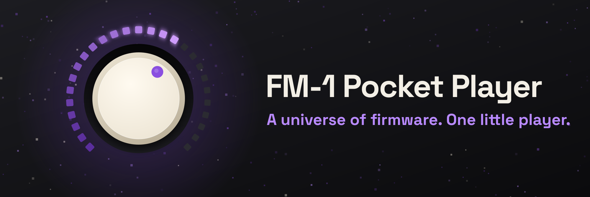

<h1 align="center">FM-1 Pocket Player</h1>

<strong>A universe of firmware. One little player.</strong>

  <a href="https://slowphase.github.io/fm1-pocket-player/"><strong>▶ Play in your browser</strong></a>
  &nbsp;·&nbsp;
  <a href="https://github.com/slowphase/fm1-pocket-mac"><strong>Get the Mac app</strong></a>

Explore M-VAVE FM-1 community firmware instantly, in your browser, without installing anything. Pick a firmware
and its screen, sound, knobs and keys come to life on the page. No FM-1 needed.

It is a place to discover and audition firmware, not a music production app.

## What you can do

- **Discover firmware.** A library that keeps itself up to date, with a picture and a short description for each
  firmware. Search, filter by category, and sort by latest release or A to Z. New to library shows what joined in
  the last two weeks.
- **Hear it.** The whole FM-1 panel: screen, keys, knobs or sliders, buttons and lights.
- **Play it your way.** Mouse, touch, your computer keyboard, or a MIDI keyboard in browsers with Web MIDI (such as
  Chrome and Edge).
- **Keep favourites**, and let each firmware remember its settings in your browser between visits.
- **Try your own files.** Open an `.rfm1` file from your computer, or drop it onto the page.

Nothing you open is uploaded anywhere: files and settings stay in your browser.

## How firmware plays

Most firmware in the library plays as an `.rfm1` build: the firmware's own code rebuilt to run in a browser.

Many firmwares can also run from their maker's original FM-1 package (`.fwsc`) on an emulation of the FM-1's chip,
and each firmware uses whichever runs it best. Where both work, you can switch between them.

> **Rolling out.** Original-package playback is switched on together with the next library update. Until then the
> player uses `.rfm1` builds only.

## Compatibility

Each firmware's details say how it was checked. Automated checks start the firmware, play it in a scripted test and
check that it makes sound and keeps time. That catches firmware that will not run, but it is not the same as someone
playing every feature, and most firmware has only passed automated checks so far. Known problems are shown as known
issues. What a firmware saves, and how, is up to the firmware.

Sound wrong? [Report a firmware problem](https://github.com/slowphase/fm1-pocket-player/issues/new?template=firmware-report.yml).

## Prefer an app?

[FM-1 Pocket for macOS](https://github.com/slowphase/fm1-pocket-mac) is the same library as a native Mac app, with
offline play and a Finder-style library.

## Credits

FM-1 Pocket Player is an independent community project. It is not affiliated with or endorsed by M-VAVE.

- Built on [Jake Handy's FM-1 Browser Simulator](https://github.com/jakehandy/fm1-browser-simulator) (MIT), with
  his [h1](https://github.com/jakehandy/h1) firmware built in.
- Every firmware is the work of its makers and keeps its own licence. Each firmware's *About this firmware* links
  to its maker and source.
- Firmware list: [The Firmware Hub](https://thefirmwarehub.com/) – thefirmwarehub.com, licensed
  [CC BY 4.0](https://creativecommons.org/licenses/by/4.0/).
- `.rfm1` builds come from [RemoteFM1FW](https://github.com/Quixotic7/RemoteFM1FW) by Michael P Jones (Quixotic7).
- Original packages run on [fm1-emu](https://github.com/joakimeriksson/fm1-emu) by Joakim Eriksson (MIT).

The player's code is MIT licensed: see [LICENSE](LICENSE).

## More

- [Report a firmware problem](https://github.com/slowphase/fm1-pocket-player/issues/new?template=firmware-report.yml)
  or [a player problem](https://github.com/slowphase/fm1-pocket-player/issues)
- For developers: [the firmware interface](docs/FIRMWARE-INTERFACE.md), [the catalogue](docs/CATALOGUE-V2.md),
  [discovery](docs/DISCOVERY.md) and [the emulator](docs/EMULATOR-INTEGRATION.md)
