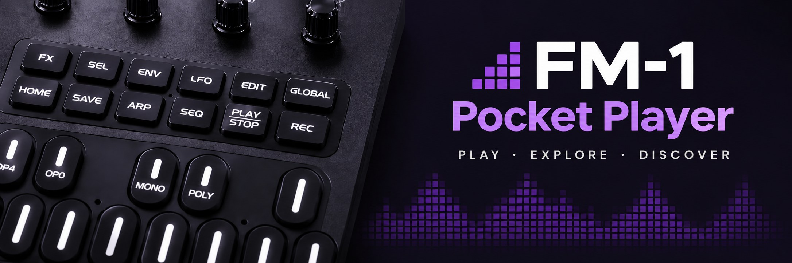
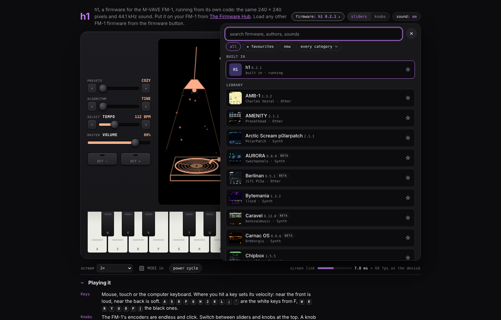

# FM-1 Pocket Player

Explore and play M-VAVE FM-1 community firmware right in your browser. There's nothing to install and no hardware needed: choose a firmware, and its screen, sound, keys and knobs come to life on the page.

**[▶ Play FM-1 Pocket Player](https://slowphase.github.io/fm1-pocket-player/)**

## Features

- A searchable firmware library with categories, screenshots and short descriptions
- Favourites, plus a badge for newly added firmware
- A library that keeps itself up to date, checking each day for new versions
- The whole FM-1 panel: screen, keys, knobs or sliders, buttons and lights, played by mouse, touch or computer keyboard
- Sound, and MIDI input from a keyboard or DAW in browsers that support Web MIDI
- Your own `.rfm1` files, opened from your computer or dropped onto the page
- Your favourites, files and each firmware's settings saved in your browser between visits

## How it works

Each firmware is an `.rfm1` file: the firmware's own code, rebuilt to run in a web browser using WebAssembly. Pocket Player steps it along the way an FM-1 would, drawing its screen and playing its sound as it goes. Every file in the library is checked before it's added.

Pocket Player can't play `.fwsc` files, the packages used to install firmware onto a real FM-1.

## Credits

FM-1 Pocket Player is built on [Jake Handy's FM-1 Browser Simulator](https://github.com/jakehandy/fm1-browser-simulator).

The firmware library is sourced from [RemoteFM1FW](https://github.com/Quixotic7/RemoteFM1FW), maintained by Michael P Jones (Quixotic7).

Each firmware remains the work of its respective authors. Individual credits, licences and source links are available under *About this firmware* in the player.

## Licence

The simulator is MIT-licensed. See [LICENSE](LICENSE). Individual firmware retains its own licence and redistribution terms.

FM-1 Pocket Player is an independent community project and is not affiliated with M-VAVE.
